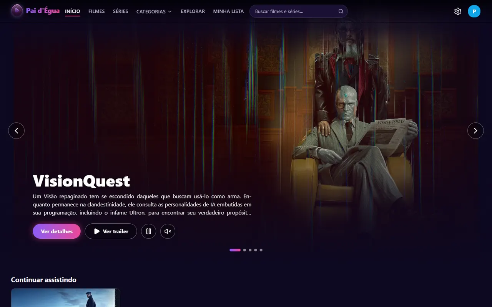
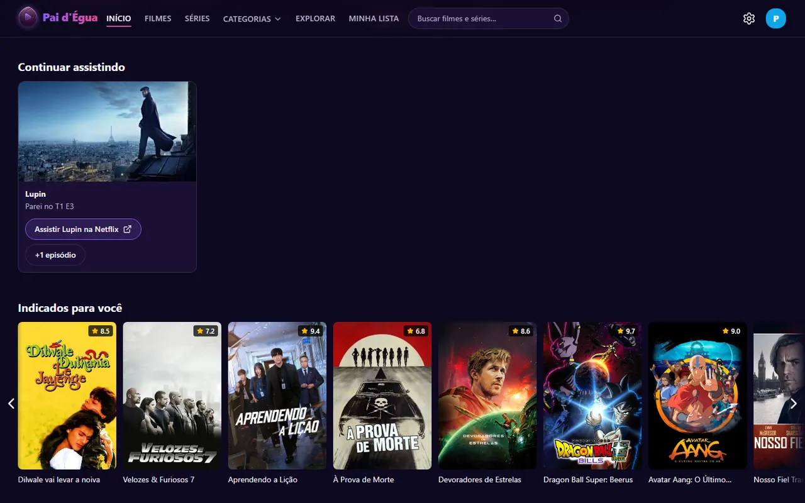
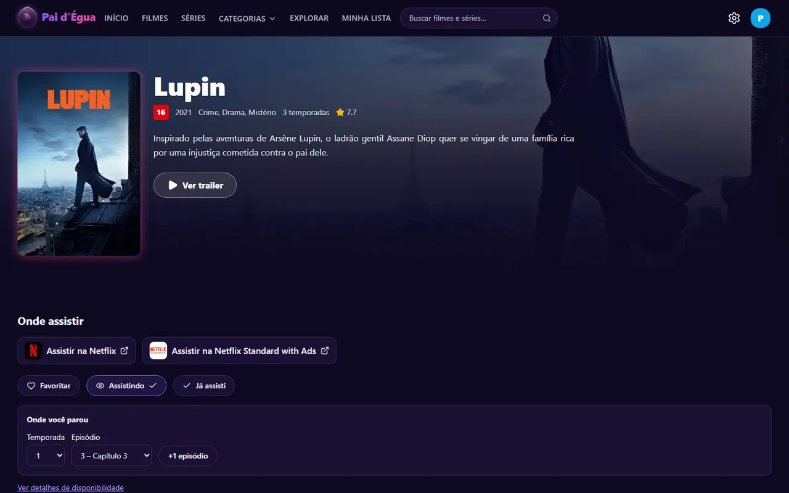
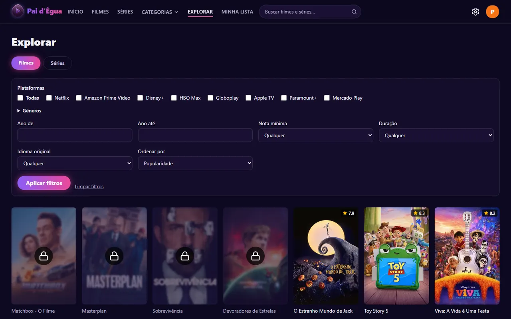
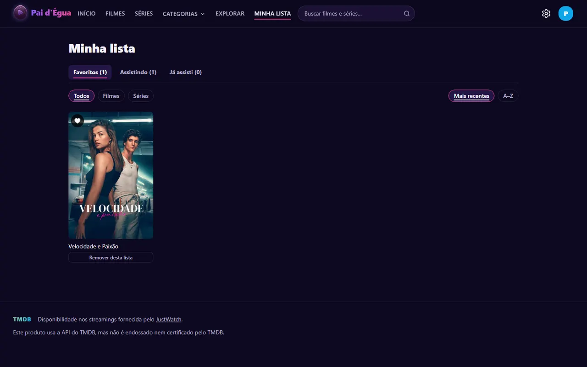
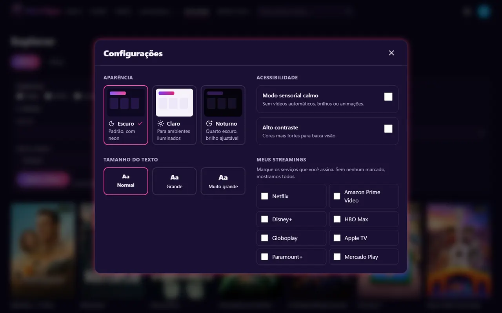

# Pai d'Égua

**Catálogo dos filmes e séries incluídos nas assinaturas de streaming no Brasil**, com contas de família, perfil Kids com controle dos pais, listas pessoais e indicações. "Pai d'égua", no Pará, quer dizer "muito bom".

> 🔗 **Ver no ar:** _link da Vercel (em breve)_ · entre em **"Experimentar sem cadastro"** para usar a conta de demonstração (PIN dos pais: `1234`).



## O que dá para fazer

- **Descobrir o que assistir** só entre o que está nas assinaturas brasileiras (Netflix, Prime Video, Disney+, HBO Max, Globoplay, Apple TV, Paramount+, Mercado Play), com trailer dublado ou legendado, sinopse, elenco, classificação indicativa e o botão que leva direto à plataforma.
- **Explorar e buscar** com filtros por plataforma, gênero, ano, nota, duração e idioma; "Como você quer se sentir hoje?" sugere filmes por humor, sem pedir nenhum dado pessoal.
- **Contas de família** com até 5 perfis e a tela "Quem está assistindo?".
- **Perfil Kids:** a criança vê o catálogo, mas títulos acima da faixa aparecem com cadeado e só abrem com o PIN dos pais. Sair do Kids ou entrar em áreas de adulto também pede o PIN.
- **Listas do perfil:** ♥ Favoritos, "Assistindo" (com "Onde você parou" e "+1 episódio" nas séries) e "Já assisti", na página **Minha lista** e na fileira **Continuar assistindo**.
- **Indicados para você**, a partir dos gêneros favoritos e do que o perfil marcou.

| Continuar assistindo e indicações | Página do título |
|---|---|
|  |  |

| Perfil Kids com cadeado | Minha lista |
|---|---|
|  |  |

## Acessibilidade

A acessibilidade foi tratada como requisito desde o começo, não como ajuste no fim:



- **Três aparências:** Escuro (padrão), Claro e **Noturno**, com brilho ajustável para quarto escuro. Cada perfil guarda as suas escolhas.
- **Modo sensorial calmo:** sem vídeos automáticos, brilhos nem animações. Pensado para pessoas sensíveis a estímulos.
- **Alto contraste** e **tamanho do texto** em três níveis.
- **Teclado do começo ao fim:** foco sempre visível, setas nas fileiras e nas abas, "Pular para o conteúdo".
- **Leitor de tela:** botões dizem o próprio estado ("Favoritar *Duna*", marcado ou não), mudanças são anunciadas, e o ♥ nunca fica dentro do link do cartaz.
- **Nada depende só de cor**, e o contraste segue a WCAG AA nos três temas.
- **Verificação automática com axe** nos testes de ponta a ponta, que falham se surgir uma violação.

## Tecnologia

| Parte | Escolha |
|---|---|
| Aplicação | Next.js 16 (App Router, Server Components e Server Actions), React 19 |
| Visual | Tailwind CSS 4, com temas por variáveis CSS |
| Dados de filmes | API do TMDB (só títulos com plataforma no Brasil), em cache por 6 a 24 h |
| Banco | PostgreSQL com Drizzle ORM e migrações; PGlite em desenvolvimento e testes, Neon em produção |
| Login | Better Auth (e-mail e senha, sessão de 30 dias), e-mail de recuperação com Resend |
| Testes | Vitest e Testing Library (unidade e componentes), Playwright com axe (ponta a ponta) |

**Alguns cuidados que valem mencionar:**
- Toda ação usa o perfil da sessão no servidor; o navegador nunca escolhe de quem é a lista.
- O cadeado do Kids é conferido no servidor, e títulos bloqueados não mandam imagem nem sinopse ao navegador. Quando o TMDB tem mais de uma classificação brasileira para o mesmo título, vale a mais restritiva.
- As marcações aparecem na hora (atualização otimista) e voltam atrás se o servidor recusar; cliques repetidos no mesmo título entram numa fila única, mesmo vindos de cartazes diferentes.
- As fileiras pessoais carregam em partes, sem atrasar o resto da página.

## Como rodar no seu computador

Requisitos: Node.js 20 ou mais novo e um token de leitura gratuito do [TMDB](https://www.themoviedb.org/settings/api).

```bash
npm install
cp .env.example .env.local   # preencha TMDB_READ_TOKEN e BETTER_AUTH_SECRET
npm run db:migrate           # cria as tabelas (PGlite numa pasta local)
npm run dev                  # http://localhost:3000
```

Testes:

```bash
npm test            # unidade e componentes
npm run test:e2e    # ponta a ponta, com um TMDB simulado e banco próprio
```

## Como o projeto foi feito

Em etapas, cada uma com especificação, plano e revisão de código antes de juntar ao `main` (os documentos estão em [`docs/superpowers`](docs/superpowers)). O andamento fica em [`docs/progresso.md`](docs/progresso.md) e as ideias para depois em [`docs/ideias-para-depois.md`](docs/ideias-para-depois.md).

| Etapa | Situação |
|---|---|
| A – Catálogo | ✅ |
| B – Contas, perfis, Kids, listas e indicações | ✅ |
| C – Assinatura (pagamento simulado) | planejada |
| D – Personalização (avatares regionais e capa do perfil) | planejada |

## Créditos

Este produto usa a API do TMDB, mas não é endossado nem certificado pelo [TMDB](https://www.themoviedb.org). A disponibilidade nos streamings é fornecida pelo JustWatch. Imagens e marcas dos filmes pertencem aos seus donos. Projeto de estudo e portfólio, sem fins comerciais.
